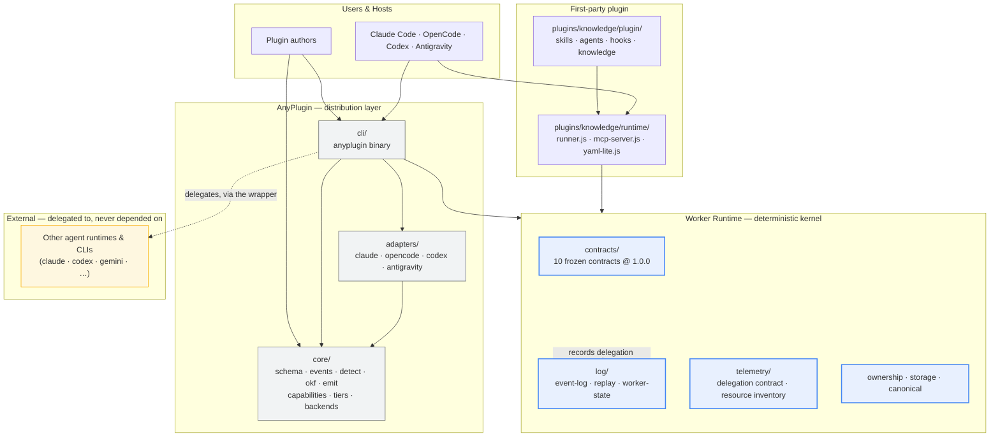
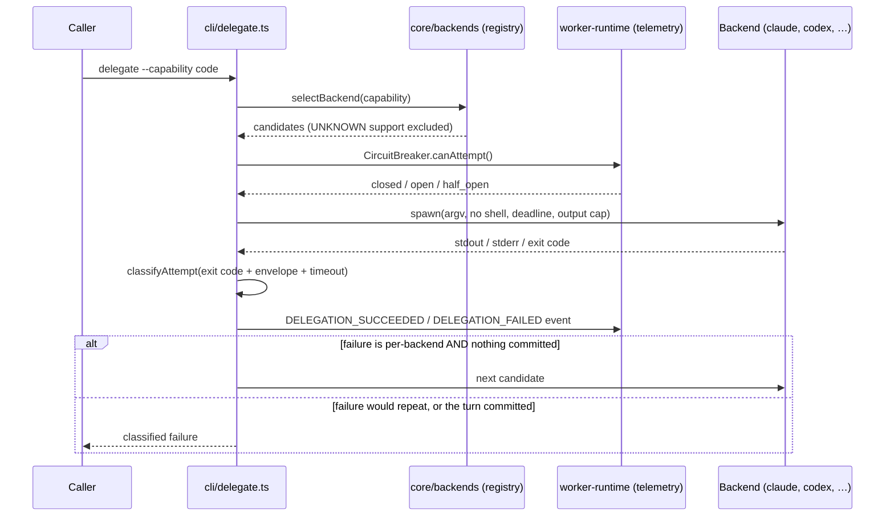

# AnyPlugin — Architecture

The single owner of the layer stack, the dependency direction, the package map,
and the "which document owns what" map.

Every other document **links** here rather than restating it. The failure mode
this file exists to prevent: seven documents each describing the architecture
slightly differently, and no way to tell which one is right.

---

## 1. The one-line version

```
One plugin source → four native bundles → reversible, journaled installs,
orchestrated by a deterministic kernel that records what happened.
```

---

## 2. Layer stack



**The dependency direction is inward.** `core` is a leaf: it depends on no
workspace package. The kernel depends on no `@lablaunchpad/*` package at all —
not even `core`, which carries agent-specific knowledge. Every other package
may point at the kernel; the kernel never points back.

This is enforced mechanically, not by convention: see
`core/src/boundaries/package-boundary.test.ts`, whose guards report
`ARMED` / `PASSED` / `FAILED` — and never report `ARMED` as `PASSED`.

---

## 3. Package map

Eight workspace packages (`pnpm-workspace.yaml`).

| Package | Role | May depend on |
|---|---|---|
| `core` | Schemas, event map, detection, OKF v0.2, emit helpers, capability matrix, tiers, backend registry | *(nothing workspace-internal)* |
| `adapters/claude` · `adapters/opencode` · `adapters/codex` · `adapters/antigravity` | Pure emitters: manifest → native bundle | `core` |
| `cli` | The `anyplugin` binary: init, detect, build, install, uninstall, intensity, okf-validate, okf-reindex, doctor, backends, delegate, run | `core`, the four adapters, `worker-runtime` |
| `packages/worker-runtime` | The deterministic kernel: contracts, canonical form, ownership, storage, event log, replay, state fold, delegation telemetry | `zod` only |
| `plugins/knowledge` | The first-party plugin: OKF knowledge layer, hook runner, MCP server | `core` (dev only) |

**The hook runtime is dependency-free by contract.** `plugins/knowledge/runtime/`
ships no `node_modules` — an emitted bundle must run on a machine that has
Node and nothing else. That is why it has its own YAML parser
(`yaml-lite.js`) instead of using the `yaml` package the CLI uses.

---

## 4. The two kernels, and why there are two

| | Worker Runtime | Hook runtime |
|---|---|---|
| Lives in | `packages/worker-runtime` | `plugins/knowledge/runtime` |
| Purpose | Authoritative, replayable state about executions | Execute ONE hook, or serve OKF over MCP |
| State | Durable event log, folded deterministically | None — stateless per invocation |
| Dependencies | `zod` | **none** |
| Knows about agents | No | Only the four host names, for output translation |

The Worker Runtime is the **deterministic kernel**: it owns what happened, and
it can prove what happened because every byte of the log is accounted for as
COMMITTED, INCOMPLETE, or REJECTED. It is the floor the distribution layer
stands on.

### What the Worker Runtime is FOR

Concretely, it exists to make four claims that a wrapper cannot make on its own:

1. **"This is what happened."** Every mutation is an event in a framed,
   hashed, single-writer log. Replay recovers the sequence exactly once, with
   every byte classified. An ad-hoc log file cannot say that.
2. **"This state has exactly one author."** A writer lock is claimed by the
   filesystem (`open(..., "wx")`), not by a check-then-act, so two writers
   cannot both believe they are alone. A stale lock is **never** auto-broken:
   a stale lock and a live second writer are indistinguishable from here, and
   breaking one to find out produces exactly the state the lock exists to
   prevent.
3. **"Nothing is manufactured."** Every quantity is classified by how it is
   known — `MEASURED`, `DERIVED`, `ESTIMATED`, `ATTESTED`, `UNKNOWN` — and an
   `UNKNOWN` quantity is absent from the record entirely, never present with a
   zero. The same rule governs failures: an unclassifiable failure is
   `unknown`, and `unknown` is not retried.
4. **"A decision can be replayed."** State is folded from the log
   deterministically, so the same bytes always produce the same state, and a
   damaged region is reported rather than silently skipped.

What it is **not**: it is not a workflow engine, not a model caller, and not a
place where an LLM decides anything. The kernel never calls a model and has
no tool executor.

---

## 5. The delegation wrapper

`anyplugin delegate` and `anyplugin backends` make AnyPlugin a front door to
other runtimes and tools.



The rules that make it safe are in `cli/src/delegate.ts` and the contract in
`packages/worker-runtime/src/telemetry/delegation.ts`:

- **Never a shell.** The command and its arguments go to `spawn` as an argv
  array, so a backend argument is data, never syntax.
- **Never unbounded.** Every attempt has a deadline and an output cap.
- **Never an unbounded environment.** The child gets an allowlist, because a
  blocklist has to anticipate every secret.
- **Never a silent failure.** Every attempt produces a classified telemetry
  event, including the ones that could not be classified.
- **Never a fallback after the turn committed.** Once output has been
  committed to the host, the chain is closed: another backend would splice two
  answers together and re-run whatever the first one already did. The kernel
  enforces it (`canFallback()`); the `anyplugin delegate` CLI buffers its
  output, so it never sets the flag — see `docs/FAILURE-MODES.md` §5 for the
  exact scope.

Two fail-policy axes, deliberately separate:

| Axis | Unknown state | Behaviour | Why |
|---|---|---|---|
| **Capability** — can this backend do this at all? | `UNKNOWN` | **Fail closed** | A wrong attempt can corrupt the workspace. Same rule as `core/src/capabilities/matrix.ts`. |
| **Health** — is this backend currently serving? | all unhealthy | **Fail open** | Refusing everything is a self-inflicted outage. The attempt may well succeed. |

---

## 6. The two install paths

Both are reversible, and both are journaled.

| | Native tier | Instruction tier |
|---|---|---|
| What | A real plugin bundle per agent | A marked `AGENTS.md` section |
| For | Agents with a plugin API | Agents without one (ponytail pattern) |
| Installed by | `anyplugin install --tier native` | `anyplugin install --tier instruction` |

Both write `.anyplugin-state.json` (the journal), which records the exact
pre-install bytes, the pre/post hashes, and the keys the plugin owns. Uninstall
restores those bytes exactly, and **aborts** rather than overwriting a file
the user edited after the install.

The native path is transactional (`cli/src/transaction.ts`):
preflight → stage → intent → backup → apply → verify → commit, with rollback
on any failure. A failed install leaves no partial state.

**The exact scope of that guarantee.** A failure *inside the process* restores
every destination. A *killed process* (crash, SIGKILL, power loss) between
`apply` and `commit` leaves the destinations mutated and the journal
unwritten — the intent and the backups survive in the transaction scratch
space, and `anyplugin doctor` reports the orphan, but **no tool yet acts on
it**. That recovery path is an open P1 in `docs/BACKLOG.md`. Stating the
boundary is the point: a guarantee that is silently narrower than advertised
is worse than no guarantee.

---

## 7. Which document owns what

| Question | Owner | Not owned by |
|---|---|---|
| What does the system look like? | **this file** | `ROADMAP.md` (strategy), `README.md` (onboarding) |
| Where does a path come from? | `core/src/fs/safe-path.ts` | any other module |
| What is the manifest? | `core/src/schema/index.ts` + `anyplugin.plugin.schema.json` | the adapters |
| What is the journal? | `cli/src/journal.ts` | `cli/src/transaction.ts` (the engine) |
| How does an install roll back? | `cli/src/transaction.ts` | `cli/src/journal.ts` |
| What is the kernel contract? | `packages/worker-runtime/src/contracts/index.ts` | `docs/WORKER-RUNTIME-KERNEL.md` (design input) |
| What does the kernel's design say, and why? | **`docs/WORKER-RUNTIME-KERNEL.md`** | the contracts (the authority) |
| What can be observed? | `packages/worker-runtime/src/resource/telemetry.ts` | prose |
| What can go wrong, and what happens? | **`docs/FAILURE-MODES.md`** | scattered prose |
| What is still open? | **`docs/BACKLOG.md`** | `ROADMAP.md` (strategy) |
| Why was it done that way? | **`docs/DECISIONS.md`** | — |
| Who is this for, and who is accountable? | **`docs/PERSONAS.md`** | `README.md` (onboarding) |
| Where does every external claim come from? | **`docs/EVIDENCE.md`** | prose |
| What did the last sessions establish? | **`docs/SESSION-LEARNINGS.md`** | — |
| Which agents are supported? | `core/src/detect/index.ts` (`ALL_AGENTS`) | `README.md` (a table that may lag) |
| What is the event map? | `core/src/events/index.ts` | `knowledge/adapters/event-mapping.md` (a drift-guarded mirror) |
| Which backends exist? | `anyplugin.backends.json` (the registry) | prose |
| What is the Agent/Worker SDK, and what does it consume? | **`docs/agent-sdk/README.md`** | — |
| How does the SDK prove what it did? | **`docs/agent-sdk/trust.md`** | — |
| How does the SDK improve itself, and how is that read? | **`docs/agent-sdk/optimization.md`** | — |
| What do caching and batching actually cost? | **`docs/agent-sdk/economics.md`** | — |
| What is the MVP roadmap, and what does each MVP ship? | **`docs/agent-sdk/roadmap.md`** | — |
| What was missing, and why did the last cycle stop at docs? | **`docs/agent-sdk/gaps.md`** | — |
| Which proven OSS repos do we depend on, and which do we build? | **`docs/agent-sdk/substrate.md`** | — |
| What tools does the Worker have, and how are they tailored by region? | **`docs/agent-sdk/tools.md`** | — |
| How is the whole thing certified? | **`docs/agent-sdk/simulations.md`** | — |
| What was learned, what was refused, and what is planned but unbuilt? | **`docs/agent-sdk/learnings.md`** | — |
| The platform patterns stolen from Linux, Debian, Android, macOS and the clouds | **`docs/agent-sdk/platform-engineering.md`** | — |
| Which adopted patterns the evidence supports, and which it does not? | `docs/PATTERNS.md` | — |
| What procedures must a change follow? | `docs/ai-native/reusable-procedures.md` | — |
| What did the external research audit find? | `docs/ai-native/harness-corpus-audit.md` | — |
| What is the strategy, milestone by milestone? | **`ROADMAP.md`** | `ARCHITECTURE.md` (shape) |
| What is true right now? | **`CURRENT_STATE.md`** | prose |
| Which defects are open, fixed, or unmapped? | **`ENGINEERING_LEDGER.md`** | `docs/BACKLOG.md` (the classified backlog) |
| What are the non-negotiable invariants? | **`CORE-INVARIANTS-V2.md`** | `AGENTS.md` (the contract table) |
| What was the original remediation, and is it done? | **`REMEDIATION_PLAN.md`** | — |
| What was the audit remediation, and is it done? | **`IMPLEMENTATION_PLAN.md`** | — |
| What is the security policy? | **`SECURITY.md`** | `docs/FAILURE-MODES.md` (the catalogue) |

**The ownership map is machine-checked.**
`core/src/boundaries/doc-ownership.test.ts` asserts that every markdown file
under `docs/`, **and every root-level plan, status or contract document**,
is named in this table; that every file this table names exists; and that
each guarded document declares a status from a closed vocabulary. A document
with no owner fails the build — a document nobody owns is a document nobody
maintains. A document whose status is not in the vocabulary also fails: a
status nobody can enumerate is a status nobody can check.

**The scope of the guard was widened once, and it mattered.** It originally
covered `docs/` only. Seven planning and status documents at the repository
root sat outside it and came to contradict each other — one declaring
"COMPLETE" while another declared "implementation not started" and a third
declared "no implementation is authorized". The guard was correct about
what it covered and blind about what mattered. See `docs/agent-sdk/gaps.md`
§1.2 and `docs/DECISIONS.md` D-048.

**Mirrors are drift-guarded, not independent.** `knowledge/adapters/event-mapping.md`
and `anyplugin.plugin.schema.json` are mirrors with a test that fails when they
drift. Prose tables in `README.md` are neither.

---

## 8. The knowledge bundle

`knowledge/` is this repository's own OKF v0.2 bundle — the same format a
plugin ships to its users. It is the working example of the format, and it is
validated in CI.

```
knowledge/
  index.md              root index (hand-curated)
  log.md                change log
  agents/               per-agent audited facts
  adapters/             event mapping + detection matrix
  formats/              the format specifications
```

`anyplugin okf-validate knowledge` checks it against the conformance matrix.
`anyplugin okf-reindex` regenerates the **sub**-directory indexes. The ROOT
`index.md` is hand-curated and is **left alone** by default; `--include-root`
is required to replace it. (It was overwritten before this cycle, which is
why the guard exists.)

---

## 9. Reading order for a new contributor

1. This file — the shape of the system.
2. `AGENTS.md` — where each contract lives, and the rules that must not be
   weakened.
3. `cli/src/index.ts` — the installer, which is the most safety-critical code.
4. `packages/worker-runtime/src/log/event-log.ts` — the kernel's write path.
5. `docs/FAILURE-MODES.md` — what goes wrong, and what the system does.
6. `docs/BACKLOG.md` — what is still open.

The "Definition of done" for any change is in `AGENTS.md`.
