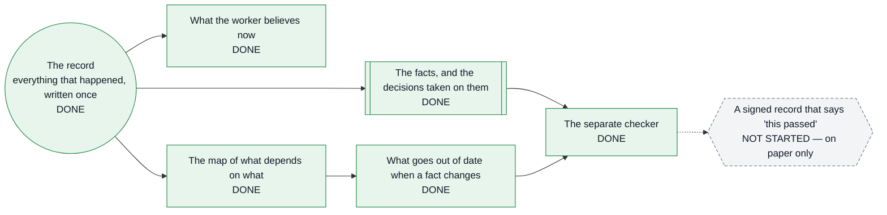
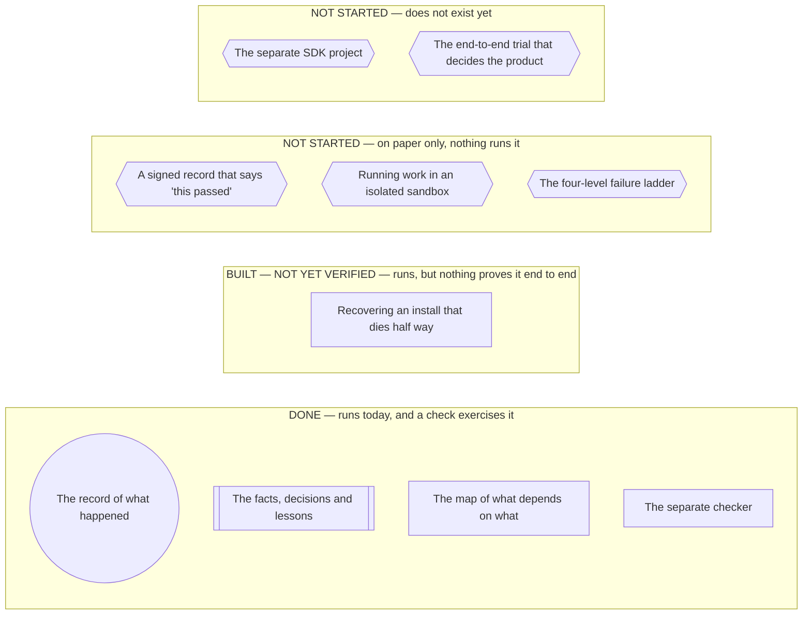
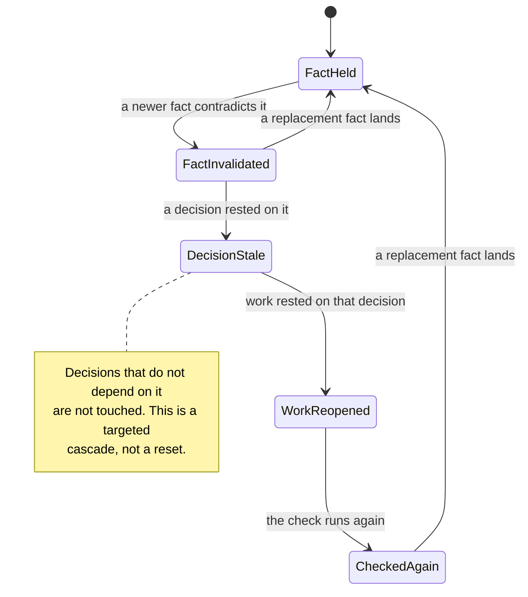
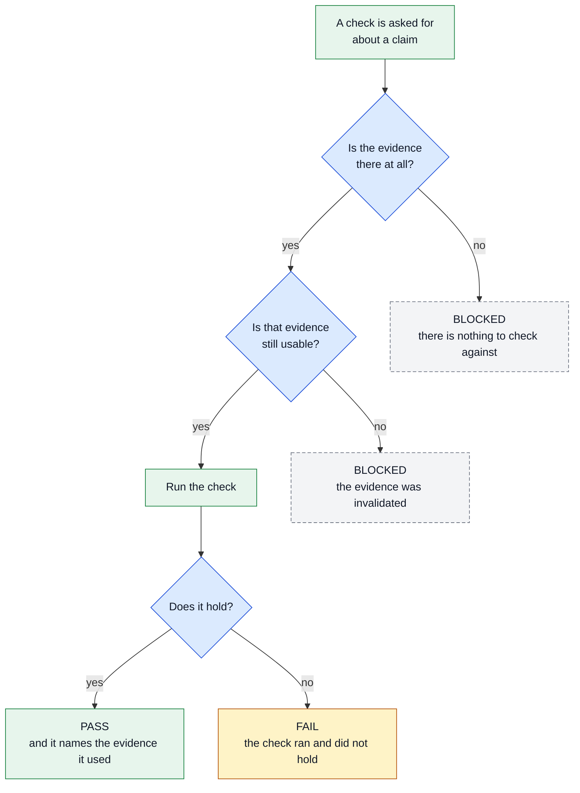
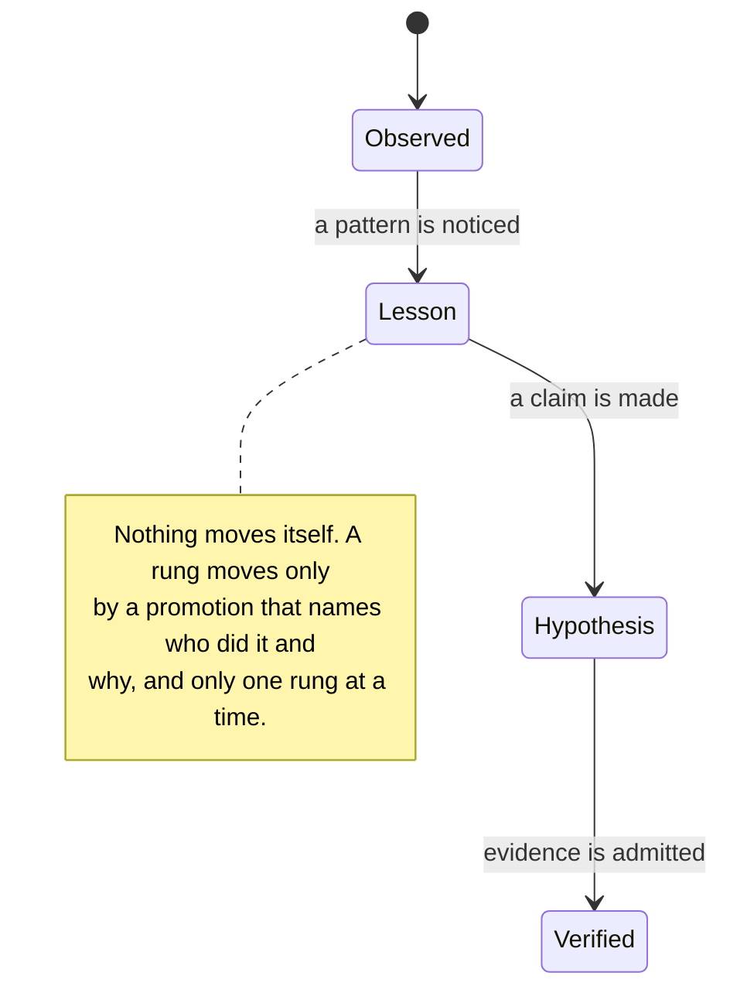
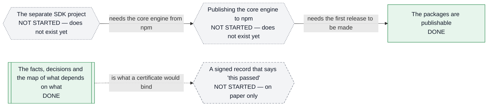
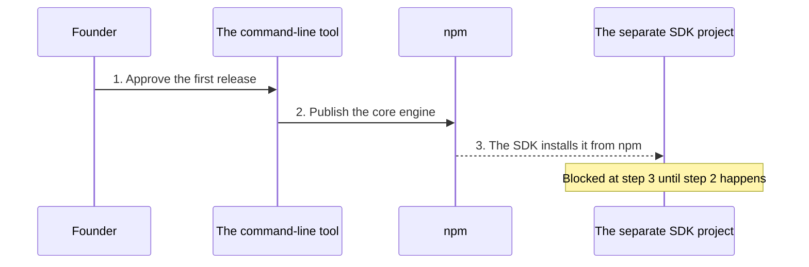
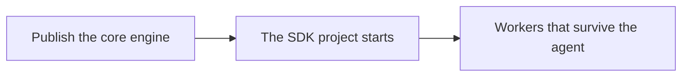

# The report format

**The contract for anything written for the person who reads the output rather
than the code.**

The person-level half of this contract — who the reader is, the 90-second
rule, how a technical term must be handled — lives in the reader's own OpenCode
configuration and applies to every project they work in. It is not reproduced
here, because it is not this repository's property and would drift.

What **is** this repository's property, and lives here:

1. the status vocabulary, because "built" means something specific here;
2. the map from this repository's internal IDs to plain language, because the
   IDs are useless to the reader;
3. the diagram vocabulary, because this system has a shape worth drawing and
   it is the same shape every time; and
4. the **linter** that checks all of the above before a report is sent.

**The linter is the point.** A stated rule that nobody checks is a
preference. Run it before sending anything:

```bash
pnpm report:lint path/to/report.md
```

It exits non-zero on an error, prints warnings, and accepts `--json`. The
rules it enforces are listed in section 7.

---

## 1. The skeleton

Seven level-2 sections, in this order. The seventh is optional.

| # | Section | What belongs in it |
| --- | --- | --- |
| 1 | **The headline** | What happened, and what the reader must do. **At most 45 words and at most 2 sentences.** |
| 2 | **Where things stand** | A table with a `Status` column. Every status is one of the six words below. |
| 3 | **What changed** | The difference since last time. |
| 4 | **What it means for the product** | The so-what, in product terms. A diagram usually lives here. |
| 5 | **Decisions I need from you** | Either *"Nothing needs your decision right now."*, or one or more decision blocks (§4). |
| 6 | **What I checked, and what's next** | The checks that passed, and the next step. Where to drill down. |
| 7 | **Words I had to use** *(optional)* | The glossary box. At most eight entries. |

**The reader has 90 seconds.** A reader who stops after the first two sections
must still have the point.

---

## 2. The status vocabulary

Six values, and the column has to carry two things at once: **how far along**
something is, and **whether it is proven**. Collapsing them is how "built"
ends up reading as "working".

| Value | Means |
| --- | --- |
| `DONE` | built, and a check exercises it |
| `BUILT — NOT YET VERIFIED` | built, but nothing proves it end to end yet |
| `IN PROGRESS` | under way |
| `NOT STARTED` | designed or absent — it does not work |
| `BLOCKED — waiting on you` | it cannot move until the reader decides |
| `BLOCKED — waiting on something else` | it cannot move until something outside this project moves |

**The rule that keeps this honest:** a schema, a type, a document, a plan, or
a contract is **never** a stand-in for an engine. A frozen contract with no
producer is `NOT STARTED`, and calling it `DONE` is the single most expensive
mistake available in this project — it is how a roadmap comes to describe a
system that does not exist.

Never round `NOT STARTED` up to `DONE`. Never round `BUILT — NOT YET
VERIFIED` up to `DONE`.

---

## 3. The internal IDs, in plain language

These IDs are how this repository navigates itself. The reader cannot use
them, so they may only ever appear *in parentheses, after* a plain-language
statement — and the parenthesis must contain nothing but IDs.

| ID | What it actually is |
| --- | --- |
| `M0` … `M12`, `M7a` | the kernel's build sequence — one chunk of the system, each with its own done-condition |
| `P1-x`, `P2-x` | an open item, ordered by severity (`P1` = serious, `P2` = smaller) |
| `D-0xx` | a recorded decision, and the reason it was made that way |
| `AP-0xx` | a recorded audit finding |
| `PM-00x` | a post-mortem: a defect that shipped, and what now prevents it |
| `U1`, `U2` | a research or exploration debt |
| `F1`, `F2` | a failure-mode class |
| `I1`, `I2` | a capability-matrix verdict |
| `L1`, `L2` | a stated gap in the trust chain |

**Allowed:** *"the part that checks the work (M7)"*.
**Not allowed:** a section headed `M7`, a table whose only column is `M7`, or
a sentence whose subject is `M7`.

The same rule applies to file paths. A path is a place to *look*, so it goes
last, in a drill-down — never as the primary evidence for a claim, and never
as the first column of a table.

---

## 4. The decision block

The reader makes the calls, so a decision request has a fixed shape so it can
be answered without re-reading the report.

```markdown
### <the question, ending in a question mark>

**Why this is yours to decide:** <what is blocked or committed until it is answered>

| Option | What you get | What it costs | My recommendation |
|---|---|---|---|
| **A** | | | **Recommended** |
| **B** | | | The fallback |

**What I will do next:** <what happens once you answer>
```

At least **two options**. If there is genuinely only one, say what you are
doing and why, rather than inventing an alternative to fill a table.

**Never end a report with an implicit question.** If nothing needs a
decision, write *"Nothing needs your decision right now."* — that is a real
answer, and it tells the reader the report is finished.

---

## 5. The diagrams

This system has one shape worth drawing, and it is the same shape every time.
The seven templates below are the ways that shape gets drawn; a report picks
the one its point needs. A diagram that does not change a decision is
decoration.

**ASCII art is not a diagram.** Use Mermaid, or a real table. Every diagram
needs **a caption that begins `Read this as:`** and **a plain-text fallback**
in a ```` ```text ```` block, for viewers that do not render Mermaid. The
fallback is arrows and indentation, never boxes.

### 5.1 The rules that hold for every diagram

1. **One diagram, one point.** The caption is the point — not a description of
   the picture. If the caption needs the word "and" to hold together, it is
   two diagrams, and the reader will read neither.
2. **The status is a word, never a colour.** Every box — or every group of
   boxes — carries one of the six status words from §2. The colour repeats
   the word; it never carries it alone.
3. **Shape is the second channel, the edge style is the third.** A diagram
   printed in black and white, or read by someone who cannot separate red
   from green, loses nothing.
4. **Under about twenty boxes, and readable in 90 seconds.** A diagram that
   takes longer to read than the sentence it replaced has failed.
5. **The plain-text fallback is linear** — arrows and indentation, never
   boxes. Box-drawing characters misalign in any proportional font and in any
   terminal that wraps.
6. **A verb on a box must match that box's status.** A part that is only
   designed never gets a verb that implies it runs.
7. **Never draw a connection that does not exist.** An edge from something
   that runs to something that is only designed is dotted, and says so.

### 5.2 The legend

Copy this beside the diagram. It is short on purpose.

```
Status — the WORD carries the meaning; the colour only repeats it:

  DONE                        runs today, and a check exercises it
  BUILT — NOT YET VERIFIED    runs today, nothing proves it end to end yet
  IN PROGRESS                 under way
  NOT STARTED                 does not work; the box says which kind
  BLOCKED — waiting on you    cannot move until the reader decides
  BLOCKED — waiting on something else
                              cannot move until something outside this project moves

Shapes:

  (( ))   the one thing everything else is computed from
  [[ ]]   a view computed from the record; never an authority itself
  [ ]     a part that runs
  { }     a question that must be answered before the next step
  {{ }}   anything that does not run yet, or that is waiting on a person

Edges:

  ==>    writes, or is authoritative for
  -->    feeds into
  -.->   would, once this exists
```

A shape only carries meaning if it is used the same way every time, so the
list above is a rule and not a suggestion: the record is always the circle,
a view is always the double bracket, a question is always the diamond, and
anything that does not run yet is always the hexagon.

### 5.3 The architecture spine — *what is this thing, and where am I in it*

Use when the reader needs the shape of the system, or needs to know which
part is real.



Read this as: everything to the right is computed from the record on the
left. If the record says otherwise, the record wins. Every link works today
except the last one — the signed record that would let a customer trust a
result.

```text
The record (DONE) -> What the worker believes now (DONE)
The record (DONE) -> The facts, and the decisions taken on them (DONE)
The record (DONE) -> The map of what depends on what (DONE)
The map of what depends on what (DONE) -> What goes out of date when a fact changes (DONE)
The facts (DONE) -> The separate checker (DONE)
What goes out of date (DONE) -> The separate checker (DONE)
The separate checker (DONE) -> A signed record that says "this passed" (NOT STARTED - on paper only)

Everything to the right is computed from the record. If the record says
otherwise, the record wins.
```

### 5.4 The status board — *what is real*

Use when the reader needs the honest picture across several areas. **Never a
traffic light** — a red/amber/green grid flattens "designed" and "absent"
into the same shape and hides the difference that matters.



Read this as: "not done" means four different things here, and only one of
them is a missing feature. The rest is a design nobody has built, a hole in
something that already runs, and a second product that has not been started.

```text
DONE - runs today, and a check exercises it
  The record of what happened
  The facts, decisions and lessons
  The map of what depends on what
  The separate checker

BUILT - NOT YET VERIFIED - runs, but nothing proves it end to end
  Recovering an install that dies half way

NOT STARTED - on paper only, nothing runs it
  A signed record that says "this passed"
  Running work in an isolated sandbox
  The four-level failure ladder

NOT STARTED - does not exist yet
  The separate SDK project
  The end-to-end trial that decides the product
```

### 5.5 The cascade — *what happens when the ground moves*

Use when the reader needs to know what happens to work already done when
something underneath it turns out to be wrong. This is a state machine, and
drawing it as anything else hides the exits.



Read this as: when a fact turns out to be wrong, only the decisions that
depended on it go out of date, only the work under those decisions reopens,
and a replacement fact puts them back.

```text
A fact is held
  -> a newer fact contradicts it
  -> the fact is invalidated
  -> a decision that rested on it goes out of date
  -> work that rested on that decision reopens
  -> the check runs again
  -> a replacement fact lands, and the chain is restored

Decisions that do not depend on it are not touched.
```

### 5.6 The gate — *can it say "pass" without proof*

Use when the reader needs to know whether the system can claim success when
it has nothing to point at. A yes-or-no question is a gate, and a gate is
drawn as a gate.



Read this as: "pass" is reachable only through three gates. Missing evidence,
or evidence that has been invalidated, produces "cannot tell" — never a quiet
pass.

*One note on vocabulary: PASS, FAIL and BLOCKED are the checker's verdicts,
not build status. They are a different axis from §2, and a box in this
diagram carries a verdict rather than a status word.*

```text
A check is asked for about a claim
  -> is the evidence there at all?      no  -> BLOCKED (nothing to check against)
  -> is that evidence still usable?     no  -> BLOCKED (the evidence was invalidated)
  -> run the check
  -> does it hold?   yes -> PASS (and it names the evidence it used)
                    no  -> FAIL
```

### 5.7 The ladder — *how much a claim is trusted*

Use when the reader needs to know how strongly the system believes
something. A ladder is a ranking; a table hides the order.



Read this as: a lesson is not knowledge, and it does not become knowledge by
sitting still. Someone has to promote it, one rung at a time, and say why.

```text
Observed
  -> Lesson      (a pattern is noticed)
  -> Hypothesis  (a claim is made)
  -> Verified    (evidence is admitted)

Nothing moves itself. A rung moves only by a promotion that names who did it
and why, and only one rung at a time.
```

### 5.8 The blocking view — *what is stopping what*

Use when the reader must decide where to push, or what to unblock first. The
edges are the answer, so every edge is labelled, and the arrow points from
the blocked thing to the thing it is waiting for.



Read this as: one blocked thing is often several blocked things wearing the
same coat — and the two blocks in this picture are different kinds. The SDK
is waiting on a release that has never been made; the signed record is
waiting on parts that already work. One needs an act from the reader, the
other needs an implementation.

```text
The separate SDK project (NOT STARTED - does not exist yet)
  --needs the core engine from npm-->
Publishing the core engine to npm (NOT STARTED - does not exist yet)
  --needs the first release to be made-->
The packages are publishable (DONE)

The facts, decisions and the map of what depends on what (DONE)
  --is what a certificate would bind-->
A signed record that says "this passed" (NOT STARTED - on paper only)
```

### 5.9 The sequence — *who does what, in what order*

Use when the reader needs to see an order and who is waiting. Use it only
when the order is the message; if only the order matters, a numbered list is
better.



Read this as: the SDK is not waiting for a feature, it is waiting for a
release. One approval from the reader unblocks it.

```text
1. The reader approves the first release
2. The command-line tool publishes the core engine to npm
3. The SDK installs the core engine from npm     <- blocked until step 2
```

### 5.10 Choosing a shape

| If the reader needs to know… | Use | Why that shape |
|---|---|---|
| how the parts fit, and which of them are real | the spine (5.3) | a chain shows the order and the break at the same time |
| what is real, what is only written down, what is missing | the status board (5.4) | the buckets sit side by side; a table would need the same reading |
| what happens to work already done when a fact turns out to be wrong | the cascade (5.5) | it is a state machine with one entry and two exits |
| whether the system can claim success without proof | the gate (5.6) | a yes-or-no question is a gate |
| how much confidence a claim is allowed to carry | the ladder (5.7) | a ladder is a ranking; a table hides the order |
| what is stopping what, and who can move it | the blocking view (5.8) | the edges are the answer |
| who does what, in what order, and where it stops | the sequence (5.9) | time and ownership in one picture |
| the status of several areas | the status table in §2 | a table is scanned; a diagram is read |
| money, time, or effort | a table with a confidence column | never a chart of invented numbers |

### 5.11 When **not** to use a diagram

- **Three facts.** A sentence or a small table is faster.
- **A number.** A table is better than a chart for one figure.
- **A category with no order.** A table carries more than a pie chart.
- **Anything the reader must read line by line.** That is a document, not a
  diagram.
- **Anything you cannot put a "Read this as:" sentence under.** If the one
  point is missing, the diagram is decoration. Cut it.
- **A table of file paths.** Say what each part does; put the paths in the
  drill-down at the end of the report.

Keep every diagram under about twenty nodes. A diagram that takes longer to
read than the sentence it replaced has failed.

### 5.12 Accessibility and honesty

- **Colour never carries meaning alone.** The status word is inside the box.
- **Never red and green as the only difference.** Use the word, and the shape.
- **Print it in black and white.** If anything is lost, the diagram is not
  finished.
- **The legend sits next to the diagram**, not in a header far away.
- **The fallback is linear.** Never boxes.
- **A designed part never gets a running verb.** "Is specified to issue" is
  honest; "issues" is not.
- **A broken chain is drawn as a broken chain.** A dotted edge to something
  that does not exist yet is the most honest mark on the page.
- **A diagram may not claim more than the repository can support.** If a part
  has no check behind it, say so on the picture, not only in the caption.

### 5.13 The anti-patterns, and what to use instead

| Anti-pattern | Why it fails the reader | Use instead |
| --- | --- | --- |
| A traffic-light grid | collapses "on paper" and "does not exist" into one colour, and "amber" means nothing to somebody who funds the work | the status board (5.4): four buckets, each with its own word |
| A flowchart that is a wall | more than about twenty boxes cannot be held in the head in ninety seconds | split it in two, or let the status table carry it |
| A pie chart of open items | a count becomes an angle, the small slices vanish, and severity disappears | the status table in §2, with the count written in words |
| Mermaid where a table is better | tracing edges is slower than reading a cell, and the reader needs the exact value | a table |
| An ASCII box diagram | box-drawing characters misalign in any proportional font and in any terminal that wraps | the linear fallback, in a `text` block |
| A diagram with no caption | the reader has to work out the point, which is the work the diagram was meant to do | "Read this as:" — one sentence, always |
| A board that is green everywhere | a flattering picture is worse than no picture: it hides the one thing you need to fund | the four kinds of not-done, named |
| A timeline with invented dates | a guessed date reads as a commitment, and this project does not make commitments it cannot keep | the sequence (5.9), or a table |

---

## 6. Words this project cannot avoid

Eight, at most. A ninth means the sentence was written badly.

| Term | What it means here |
| --- | --- |
| **the core engine** | the part of the system that survives the agent — it records, decides, and verifies |
| **the record** | the append-only log of everything that happened; the only authority |
| **a view** | something computed from the record; never an authority itself |
| **the cascade** | what gets marked out-of-date when the evidence beneath it changes |
| **the ladder** | how much confidence a lesson is allowed to carry |
| **capability matrix** | what each agent platform can actually do |
| **journal** | the record of what an install changed, so an uninstall can undo it exactly |
| **certificate** | a signature over finished work and everything it rests on |

---

## 7. What the linter checks, and what it cannot

**Mechanical — `pnpm report:lint` fails the report:**

| Rule | What it catches |
| --- | --- |
| `R-MOJIBAKE` | a corrupted character in the text |
| `R-SECTIONS-PRESENT` / `-ORDER` / `-ONCE` | a missing, misordered, or duplicated section |
| `R-HEADLINE-LENGTH` | a headline longer than 45 words or 2 sentences |
| `R-HEADLINE-ASK` *(warning)* | a headline that does not say what the reader must do |
| `R-STATUS-TABLE` / `R-STATUS-VOCABULARY` | a missing status board, or a status outside the six words |
| `R-INTERNAL-ID-HEADING` / `-UNGLOSSED` | an internal ID used as a heading, or used without a plain-language phrase |
| `R-PATH-SPINE` | a table whose first column is mostly file paths |
| `R-STALE-COUNT` | a quoted count of tests, which goes stale |
| `R-DIAGRAM-PRESENT` / `-CAPTION` / `-FALLBACK` | a missing diagram, a missing `Read this as:` caption, a missing plain-text fallback |
| `R-DECISION-EMPTY` / `-TABLE` / `-WHY` / `-NEXT` | an empty decision section, or a decision block missing its shape |
| `R-GLOSSARY-LIMIT` | a glossary longer than eight entries |
| `R-JARGON-UNGLOSSED` *(warning)* | a technical term used without a gloss |
| `R-BOX-DRAWING` *(warning)* | a plain-text fallback drawn with boxes instead of arrows |
| `R-DECISION-QUESTION` *(warning)* | a decision heading that is not phrased as a question |

**Not mechanical — a human, or a model, decides:**

- whether a status word is *true*;
- whether a diagram makes its one point obvious;
- whether the glossary is short enough;
- whether the bad news came first.

Those are the ones that matter most, and no test can substitute for them.

**This document is not a report.** Running the linter on *this* file reports
errors, and that is correct: it names the internal IDs on purpose (section 3),
and it is a specification rather than a message to the reader. The thing that
must obey the format is the example in the next section, and that is what the
guard lints.

---

## 8. The canonical example

The example below is **linted by the build**. The guard extracts it, lints it,
and requires **zero errors** — so the published example obeys the published
guard. If you change a rule, this example must change with it.

<!-- report-example:begin -->

```markdown
# Publishing the packages — the SDK can finally start

## The headline

The three packages are now publishable and a check enforces it, so the separate SDK project can install the core engine from npm instead of a local folder. You need to log in to npm and approve the first release.

## Where things stand

| What | Status |
|---|---|
| The core engine package | DONE |
| The linter that checks a report before it is sent | DONE |
| The first release on npm | IN PROGRESS |
| The separate SDK project | NOT STARTED |

## What changed

The packages used to carry no licence, no repository field and no file allowlist, so publishing them would have shipped every source file and every compiled test. They now carry the metadata npm needs, ship only the built output, and a check fails the build if any of that regresses.

## What it means for the product

The SDK is a separate repository that installs the core engine from npm. Until the packages are published, half the product has nothing to build on. This closes that, and it also makes the starter template's own instruction to run the tool with npx true rather than aspirational.



Read this as: one published package unblocks the entire second half of the product.

```text
Publish the core engine -> The SDK project starts -> Workers that survive the agent
```

## Decisions I need from you

### Do we publish all three packages at once, or the core engine first?

**Why this is yours to decide:** a published version can never be taken back, and the first release is the one other projects build against.

| Option | What you get | What it costs | My recommendation |
|---|---|---|---|
| **A** — the core engine first | The SDK can start this week | The starter template's npx instruction stays untrue for another release | **Recommended** |
| **B** — all three at once | Everything is installable in one go | One mistake is published three times | The fallback |

**What I will do next:** if you choose A, I publish only the core engine this week and the other two once their first release has been rehearsed.

## What I checked, and what's next

The build is clean, the full suite passes, and the publishing check confirms each tarball contains the built output and no source. Next: log in to npm and publish, then start the SDK repository against the published package.

## Words I had to use

| Term | What it means here |
|---|---|
| the core engine | the part of the system that survives the agent — it records, decides and verifies |
| the record | the append-only log of everything that happened; the only authority |
```

<!-- report-example:end -->

---

## 9. How this document stays true

| Claim type | How it is kept true |
| --- | --- |
| The status words | the linter's closed vocabulary, and the guard that fires each rule |
| The linter's rules | `core/src/boundaries/report-format.test.ts` fires every rule against a report that breaks exactly that rule |
| The canonical example | the same guard lints it and requires zero errors |
| The decision shape | the same guard, via `R-DECISION-TABLE` |
| The legend and the linter agree | the same guard compares the legend in section 5 with the linter's own list, in both directions |
| The words and the linter agree | the same guard compares the eight words in section 6 with the linter's list, in both directions |
| The rule list is complete | the same guard compares every rule the linter can emit with the table above, in both directions |
| Every diagram template is complete | the same guard checks each Mermaid block in section 5 for its caption and its plain-text fallback |
| That this document exists and is owned | `core/src/boundaries/doc-ownership.test.ts` |
| That `AGENTS.md` points at it | `core/src/boundaries/report-format.test.ts` |

**A rule that is defined, unit-tested, and never used is the same failure
shape as a rule that is defined and never used.** That is why the guard fires
every rule rather than sampling.
