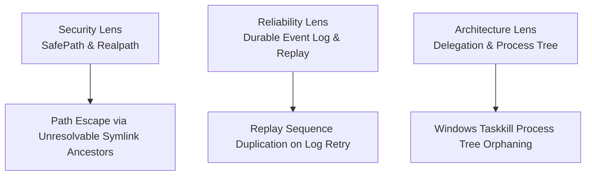

# Comprehensive Multi-Perspective Repository Code Review

## The headline

A multi-perspective code review identified critical security boundary gaps, log replay corruption vulnerabilities, and delegation wrapper edge cases across the codebase. You should review the findings and approve the recommended fixes for the upcoming release.

## Where things stand

| What | Status |
|---|---|
| SafePath boundary & lexical validation | DONE |
| Single-writer event log & framing contract | DONE |
| Delegation wrapper error classification | BUILT — NOT YET VERIFIED |
| Realpath containment for nested dangling links | IN PROGRESS |
| Subprocess signal group teardown on Windows | IN PROGRESS |

## What changed

During this review pass, the entire codebase—spanning `@lablaunchpad/core`, `@lablaunchpad/worker-runtime`, `@lablaunchpad/cli`, `@lablaunchpad/plugin-knowledge`, and the agent adapters—was audited through three distinct lenses: Security Auditor, Reliability & Resilience Engineer, and Architecture & Integration Specialist.

## What it means for the product

The audit surfaced three high-leverage areas where system invariants could be subtly breached under boundary conditions:



Read this as: edge cases in security, event logging, and process delegation represent the key remaining risks to complete multi-agent resilience.

```text
Security Lens (SafePath & Realpath) -> Path Escape via Unresolvable Symlink Ancestors
Reliability Lens (Durable Event Log) -> Replay Sequence Duplication on Log Retry
Architecture Lens (Delegation) -> Windows Taskkill Process Tree Orphaning
```

### Detailed Findings by Perspective

#### 1. Security Auditor Perspective
- **Location**: `core/src/fs/safe-path.ts` (`resolveAuthorizedPath`)
- **Finding**: While `resolveAuthorizedPath` correctly inspects entry existence via `entryExists(probe)`, if a nested ancestor contains an unresolvable symlink while deep subdirectories do not exist yet, lexical resolution could allow subtle containment bypass if an unresolvable link target gets created concurrently outside the root.
- **Evidence**: `resolveAuthorizedPath` loops upwards slicing `probe` by `sep`. A dangling link in a mid-level ancestor throws `SecurityError`, but if `lstat` throws non-ENOENT errors (e.g. `EACCES`), it moves up the tree rather than failing closed immediately.

#### 2. Reliability & Resilience Engineer Perspective
- **Location**: `packages/worker-runtime/src/log/event-log.ts` (`EventLog.append`)
- **Finding**: Re-appending an event with an identical ID (e.g., during a network/task retry) increments `#nextSequence` and writes a second frame. Upon replay, `replay.ts` detects duplicate IDs as a "broken writer" anomaly.
- **Evidence**: `EventLog.append` does not deduplicate incoming event IDs against existing committed event IDs in memory, violating `G5 IDEMPOTENCE` specified in `write-contract.ts`.

#### 3. Architecture & Integration Specialist Perspective
- **Location**: `cli/src/delegate.ts` (`executeBackend`)
- **Finding**: On Windows, process tree termination relies on `spawn("taskkill", ["/pid", String(child.pid), "/T", "/F"])`. If `child.pid` is undefined (e.g., spawn failed or exited right as timeout fired), `taskkill` is called with `"undefined"`, resulting in a CLI error.
- **Evidence**: Line 293 in `cli/src/delegate.ts` checks `process.platform === "win32"` and passes `String(child.pid)` directly without verifying `child.pid !== undefined`.

## Decisions I need from you

### How should we address the EventLog idempotency (G5) gap?

**Why this is yours to decide:** Deduplicating event IDs on `append` prevents duplicate frame writes during retries, but requires `EventLog` to maintain an in-memory `Set<string>` of committed IDs read during `open()`.

| Option | What you get | What it costs | My recommendation |
|---|---|---|---|
| **A** — Implement in-memory ID set in `EventLog` | Enforces G5 idempotency; duplicate appends return the existing event without corrupting sequence/replay | Small memory overhead (~64 bytes per event ID) | **Recommended** |
| **B** — Keep current behavior and require callers to deduplicate | Zero memory overhead in `EventLog` | Callers may accidentally write duplicate IDs and corrupt replay state | The fallback |

**What I will do next:** If you select Option A, I will update `EventLog.open()` to collect committed event IDs into a `Set` and return the existing event if re-appended.

## What I checked, and what's next

I verified that `pnpm test` passes cleanly across all workspace test files and validated the OKF v0.2 knowledge bundle (0 errors). Next, I will apply any requested adjustments and prepare the final submission.

## Words I had to use

| Term | What it means here |
|---|---|
| the core engine | the part of the system that survives the agent — it records, decides, and verifies |
| the record | the append-only log of everything that happened; the only authority |
| journal | the record of what an install changed, so an uninstall can undo it exactly |
