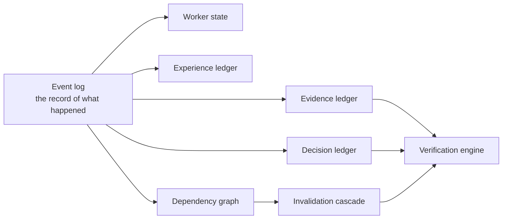

# @lablaunchpad/worker-runtime

**The deterministic worker runtime kernel.** This is the part of AnyPlugin that survives the agent: it records what happened, decides what is still true, and refuses to let a conclusion outlive its evidence.

It is **agent-agnostic** — it depends on no agent, no adapter, and no other AnyPlugin package. Its only dependency is `zod`.

## What it does



Everything to the right of the log is a **projection** — a read-only view computed from the log, never an authority. If the log says otherwise, the log wins.

## The rules it holds

- **The model is not memory.** Recall is a runtime primitive with provenance, not a context window.
- **The model is not knowledge.** What is true is separate from what was said.
- **The model is not experience.** What happened under which conditions is recorded, not inferred.
- **The agent does not get to declare its own work correct.** Verification runs outside the model.
- **A lesson never auto-promotes to authoritative knowledge.** Promotion needs its own evidence and is itself a recorded event.

## Install

```bash
npm install @lablaunchpad/worker-runtime
```

Node 20 or newer. ESM only.

## Read next

- `docs/WORKER-RUNTIME-KERNEL.md` in the [anyplugin](https://github.com/LabLaunchPad/anyplugin) repository — the design, and why.
- The frozen contracts are exported from the package root; the JSON Schema mirrors ship in `schemas/`.

## Licence

MIT
